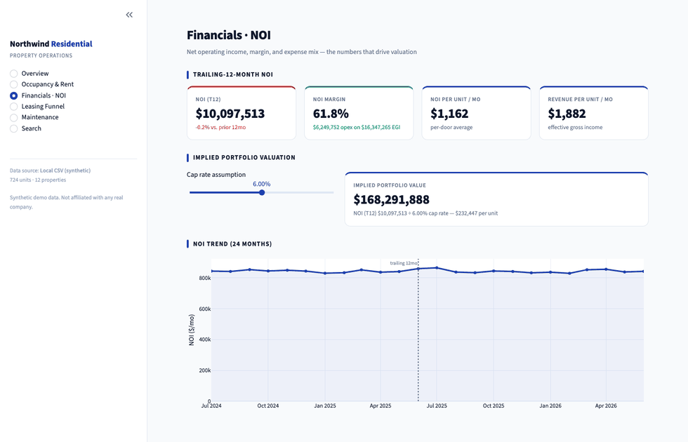

# Northwind Residential | Property Operations Dashboard

[](https://northwind-dashboard-82q7dco7ckuydu5tfaqwh9.streamlit.app/)
[](https://github.com/mathiasmendezm/northwind-dashboard/actions/workflows/tests.yml)
[](LICENSE)

**[Live demo →](https://northwind-dashboard-82q7dco7ckuydu5tfaqwh9.streamlit.app/)**

An executive dashboard for a multifamily property-management operator, built with
**Streamlit + Plotly** on a **Supabase-ready data layer**. It surfaces occupancy,
rent collections, unit turnovers, resident retention, revenue leakage,
leasing-funnel conversion, and maintenance operations across a portfolio of
Los Angeles properties, and opens on one chart that shows where this month's
rent went.

> **Portfolio demo.** Every figure here is randomly generated by
> [`generate_data.py`](generate_data.py). "Northwind Residential" is a fictional
> company whose 12 fictional properties sit in real Los Angeles neighborhoods.
> There is no real, scraped, or client data anywhere in this repository.



## What it demonstrates

- **Multi-page analytics UI** — Executive Summary, Overview, Occupancy & Rent,
  Collections, Turnovers, Lease Management, Retention, Financials · NOI,
  Leasing Funnel, Maintenance, and a cross-dataset Search, with a custom
  design system (not the default Streamlit theme).
- **"Where this month's rent went"** — the Executive Summary opens on a
  waterfall from market rent potential to rent actually collected, one bar per
  leak (loss to lease, vacancy, concessions, unpaid rent), following the NAA
  revenue chain. Tabs under the chart list the units behind each bar, so the
  owner's question "where did the money go?" ends in a to-do list.
- **Executive Summary with rule-based recommendations** —
  [`insights.py`](insights.py) scores the portfolio against the same
  thresholds already used as color-coding elsewhere (93%/88% occupancy,
  60%/50% NOI margin, collection rate, past-due balances, bad debt, days
  vacant, units stuck in make-ready, renewal rate, work-order aging,
  lease-renewal exposure, funnel drop-off) and returns a prioritized,
  plain-English action list for leadership. Deterministic and fully
  unit-tested — not an LLM call, so it's free to run and its output never
  varies between runs of the same data.
- **Collections** — collection rate this month by property and over 12 months,
  past-due balances in the standard aged-receivables buckets (0–30, 31–60,
  61–90, 90+ days), balances tied up in evictions, bad debt written off, and a
  "who to call today" list with each household's collection stage.
- **Turnovers** — days vacant between residents split into make-ready time
  (maintenance's clock) and time waiting for a lease (leasing's clock), units
  stuck in make-ready, rent lost on every vacant unit so far, and turn cost by
  scope.
- **Retention** — renewal rate by property, renewal rent increases against
  new-lease rents, why residents moved out (with the reasons a manager can
  influence highlighted), and renewals vs. move-outs by month.
- **Calibrated to Los Angeles** — rents (~$2,500 average market rent),
  occupancy in the mid-95% range, and LA's Rent Stabilization Ordinance:
  buildings built before 1978 carry long-tenured residents far below market,
  renew more often, get capped renewal increases, and reset toward market on
  turnover. The waterfall and the renewal-pricing recommendation separate the
  below-market gap that can be closed at renewal from the part locked in
  rent-stabilized units.
- **Editable targets** — a "Targets" panel in the sidebar moves the green and
  red line for occupancy, NOI margin, collections, past-due balances, bad debt,
  make-ready, days vacant and renewals. Every color, chart line and
  recommendation follows, so an operator can see the portfolio against their
  own goals during a demo.
- **Executive KPI + Plotly visualizations** — physical vs. economic occupancy,
  loss-to-lease, vacancy exposure, funnel conversion, work-order aging and spend.
- **NOI-driven financials page** — trailing-12 vs. prior-12 NOI and its
  year-over-year delta, NOI margin, opex ratio, revenue/NOI per unit, an
  opex breakdown by category (property tax, insurance, utilities, payroll,
  repairs & maintenance, contract services, marketing/turnover), and an
  implied portfolio valuation off a user-adjustable cap-rate slider — the
  indicators an owner or investor actually tracks, not just occupancy counts.
- **Lease management** — upcoming expirations bucketed by month, renewal
  exposure in $ at risk over the next 30/60/90 days, and a holdover-tenant
  report (occupied units past their original lease term with no renewal on
  file) — the operational counterpart to the NOI page's financial view.
- **Pluggable data layer** — [`data_source.py`](data_source.py) reads from
  **Supabase** when credentials are present and falls back to local CSVs
  otherwise. Swapping backends is a config change, not a code change.
- **Messy-export cleaning pipeline** — [`cleaning.py`](cleaning.py) turns a raw
  property-management CSV export (junk preamble rows, `$1,234.00` money strings,
  addresses glued onto property names) into an analysis-ready frame.
- **Tested and CI-checked** — a [pytest](tests/) suite (~90% coverage) covers
  the cleaning pipeline, the data-source fallback logic, the synthetic-data
  generator (including the NOI math), and a full app-level smoke test that
  renders every page headlessly and fails the build if any of them raises;
  [GitHub Actions](.github/workflows/tests.yml) runs lint (`ruff`), tests with a
  coverage gate, and a `pip-audit` dependency vulnerability scan on every push
  and pull request.

## Tech stack

Python · Streamlit · Plotly · pandas · NumPy · Faker · (optional) Supabase

## Quick start

```bash
pip install -r requirements.txt
python generate_data.py     # writes synthetic CSVs into ./data
streamlit run app.py
```

The app opens on the Overview page. No credentials or setup required — it runs
entirely on the local synthetic data.

## Testing

```bash
pip install -r requirements-dev.txt
ruff check .                              # lint
pytest -v --cov --cov-report=term-missing # unit tests + full-app smoke test + coverage
pip-audit -r requirements.txt -r requirements-dev.txt  # dependency vulnerability scan
```

The same commands run in CI (see badge above) on every push and pull request,
against a freshly regenerated dataset — so a broken generator, a regression in
the cleaning pipeline, a page that throws at runtime, a coverage drop below
80%, or a dependency with a known CVE all fail the build, not just a demo.

## Using a real Supabase backend (optional)

1. Create tables named `properties`, `rent_roll`, `work_orders`,
   `financials_monthly`, `leasing_funnel`, `applications`, `leads`,
   `lease_events`, `turns`, `receivables`, `collections_monthly`.
2. Copy `.streamlit/secrets.toml.example` to `.streamlit/secrets.toml` and fill in
   `SUPABASE_URL` / `SUPABASE_KEY` (or set them as environment variables).
3. `pip install supabase`, then `streamlit run app.py`.

The sidebar shows which source is active (`Supabase` vs. `Local CSV`).

## Project layout

```
app.py               Entry point: page config, data loading, sidebar, routing
ui/                  Design tokens, Plotly theme, CSS, chart-builder helpers
views/               One module per page (summary, overview, collections, turnovers, ...)
metrics.py           Shared calculations and thresholds for collections, turnovers, retention
insights.py          Rule-based recommendation engine for the Executive Summary page
data_source.py       Supabase-or-CSV data access layer
generate_data.py     Synthetic data generator (Faker + NumPy, fixed seed)
cleaning.py          Raw-export cleaning pipeline (+ runnable demo)
constants.py         Shared constants (e.g. the fixed "as of" date)
data/                Generated synthetic CSVs (committed so it runs on clone)
tests/               pytest suite for the generator, cleaner, data layer, and app smoke test
.github/workflows/   CI: lint, tests + coverage gate, pip-audit on every push/PR
requirements.txt     Pinned runtime dependencies
requirements-dev.txt Adds pytest, pytest-cov, ruff, pip-audit for local development
```

## Notes

The data model mirrors the shape of common property-management exports (rent roll,
work orders, leasing funnel, guest cards/leads, monthly financials, aged
receivables, lease renewals and move-outs, unit turns) so the analytics are
realistic, but all values are synthetic and reproducible via the fixed random
seed. Rents, occupancy, rent stabilization, concessions (concentrated in new
Class A buildings), delinquency and turn costs are tuned to the benchmarks
above and to published Los Angeles figures where they exist; where no LA
figure was found (days vacant, turn cost), national benchmarks are used.

The NOI model in `financials_monthly` is a simplified stand-in for a real
operating statement: opex per category is generated as a class-adjusted share
of effective gross income (industry rule-of-thumb ratios), not itemized
ledger entries. It's built to demonstrate the *shape* of NOI analysis — trend,
margin, YoY, opex mix, cap-rate-implied valuation — not to model any specific
property's actual books.

## Benchmarks behind the thresholds

The default red / amber / green lines are judgment calls anchored to
published 2025–2026 figures, not industry standards. They live in
[`metrics.py`](metrics.py) (`Targets`), so changing a default updates every page
and the recommendation engine at once; viewers can also override them for their
session from the sidebar.

| Metric | Green / amber / red | Anchor |
|---|---|---|
| Occupancy | ≥ 95% / 92–95% / < 92% | Los Angeles occupancy in the mid-95% range (Essex, Q3 2026 earnings call) |
| Collection rate this month | ≥ 98% / 96–98% / < 96% | Large apartment REITs report net bad debt of 0.2–1% of revenue (e.g. [Equity Residential Q2 2026](https://investors.equityapartments.com/news-events/press-releases-news/news-details/2026/Equity-Residential-Reports-Second-Quarter-2026-Results/default.aspx), [Camden Q3 2025](https://seekingalpha.com/pr/20298017-camden-property-trust-announces-third-quarter-2025-operating-results)) |
| Past-due balance ÷ a month's rent | ≤ 3% / 3–5% / > 5% | Common rule of thumb in property-management KPI guides: delinquency persistently above 3–5% signals screening or collections gaps. Gross balances here include units in eviction |
| Bad debt, trailing 12 months | ≤ 1% / 1–2% / > 2% | Independence Realty Trust's goal of keeping bad debt below 1% of revenue ([Q3 2025 call](https://www.insidermonkey.com/blog/independence-realty-trust-inc-nyseirt-q3-2025-earnings-call-transcript-1638597/)) |
| Make-ready days | ≤ 10 / 10–15 / > 15 | NAA: ~7 working days is the common guideline ([NAA, Apartment Turnover](https://naahq.org/sites/default/files/2025-03/01a.%20Apartment%20Turnover%202025.pdf)) |
| Days vacant between residents | ≤ 30 / 30–45 / > 45 | National average of 41 days in 2025 ([RentCafe / Yardi](https://www.rentcafe.com/blog/rental-market/market-snapshots/most-competitive-rental-markets-this-year/)) |
| Renewal rate | ≥ 55% / 45–55% / < 45% | ~56% of H1-2026 expirations renewed ([RealPage via LeaseLock](https://leaselock.com/greg-willett-signposts-multifamily-resident-retention-renewal-pricing-power/)) |
| Controllable move-outs | watch above 40% | ~46% of potential move-outs are for controllable reasons ([J Turner Research](https://www.jturnerresearch.com/blog/to-renew-or-not-renew-understanding-why-residents-choose-to-move)) |

Turn cost and renewal vs. new-lease rent change are shown without a color: no
current benchmark could be verified, and local rent caps limit renewal
increases in many markets. The waterfall follows the NAA's revenue chain
([CAM financial terms](https://naahq.org/cam-terms-formulas)).

## License

MIT — see [LICENSE](LICENSE). Free to clone, run, and adapt.

## About / Contact

Built by **Mathias Mendez** as a freelance portfolio piece — a self-contained
example of a data dashboard done properly: a clean data layer with a real
backend seam (Supabase or CSV), an executive-ready UI, a cleaning pipeline for
messy real-world exports, and a tested, CI-checked codebase rather than a
one-off script.

- Email: [mathiasmmendezm@gmail.com](mailto:mathiasmmendezm@gmail.com)
- LinkedIn: [linkedin.com/in/mathias-mendez-martinez](https://www.linkedin.com/in/mathias-mendez-martinez)
- GitHub: [github.com/mathiasmendezm](https://github.com/mathiasmendezm)

Open to freelance and contract work in Python data/analytics dashboards.
