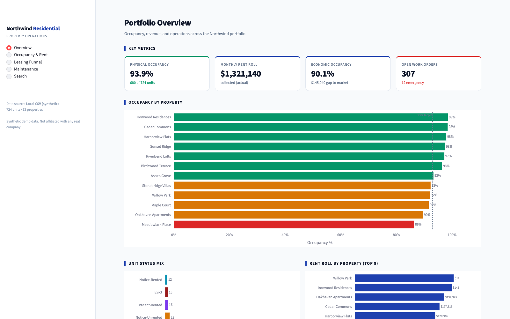

# Northwind Residential | Property Operations Dashboard

An executive dashboard for a multifamily property-management operator, built with
**Streamlit + Plotly** on a **Supabase-ready data layer**. It surfaces occupancy,
revenue leakage, leasing-funnel conversion, and maintenance operations across a
portfolio of properties.

> **Portfolio demo.** Every figure here is randomly generated by
> [`generate_data.py`](generate_data.py). "Northwind Residential" is a fictional
> company. There is no real, scraped, or client data anywhere in this repository.



## What it demonstrates

- **Multi-page analytics UI** — Overview, Occupancy & Rent, Leasing Funnel,
  Maintenance, and a cross-dataset Search, with a custom design system (not the
  default Streamlit theme).
- **Executive KPI + Plotly visualizations** — physical vs. economic occupancy,
  loss-to-lease, vacancy exposure, funnel conversion, work-order aging and spend.
- **Pluggable data layer** — [`data_source.py`](data_source.py) reads from
  **Supabase** when credentials are present and falls back to local CSVs
  otherwise. Swapping backends is a config change, not a code change.
- **Messy-export cleaning pipeline** — [`cleaning.py`](cleaning.py) turns a raw
  property-management CSV export (junk preamble rows, `$1,234.00` money strings,
  addresses glued onto property names) into an analysis-ready frame.

## Tech stack

Python · Streamlit · Plotly · pandas · NumPy · Faker · (optional) Supabase

## Quick start

```bash
pip install -r requirements.txt
python generate_data.py     # writes synthetic CSVs into ./data
streamlit run app.py
```

The app opens on the Overview page. No credentials or setup required — it runs
entirely on the local synthetic data.

## Using a real Supabase backend (optional)

1. Create tables named `properties`, `rent_roll`, `work_orders`,
   `leasing_funnel`, `applications`, `leads`.
2. Copy `.streamlit/secrets.toml.example` to `.streamlit/secrets.toml` and fill in
   `SUPABASE_URL` / `SUPABASE_KEY` (or set them as environment variables).
3. `pip install supabase`, then `streamlit run app.py`.

The sidebar shows which source is active (`Supabase` vs. `Local CSV`).

## Project layout

```
app.py              Streamlit dashboard (pages, charts, styling)
data_source.py      Supabase-or-CSV data access layer
generate_data.py    Synthetic data generator (Faker + NumPy, fixed seed)
cleaning.py         Raw-export cleaning pipeline (+ runnable demo)
data/               Generated synthetic CSVs (committed so it runs on clone)
requirements.txt
```

## Notes

The data model mirrors the shape of common property-management exports (rent roll,
work orders, leasing funnel, guest cards/leads) so the analytics are realistic,
but all values are synthetic and reproducible via the fixed random seed.
